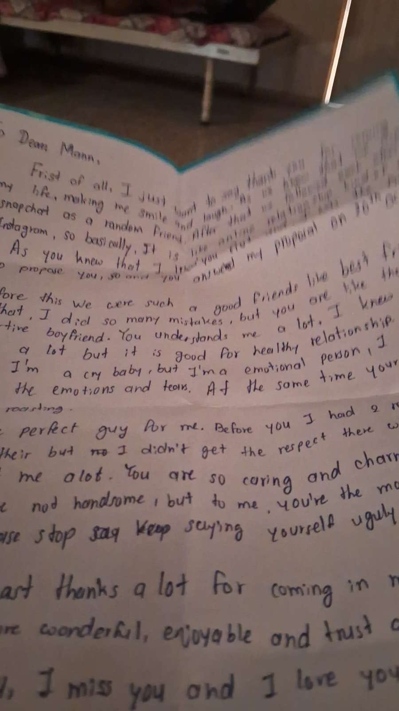
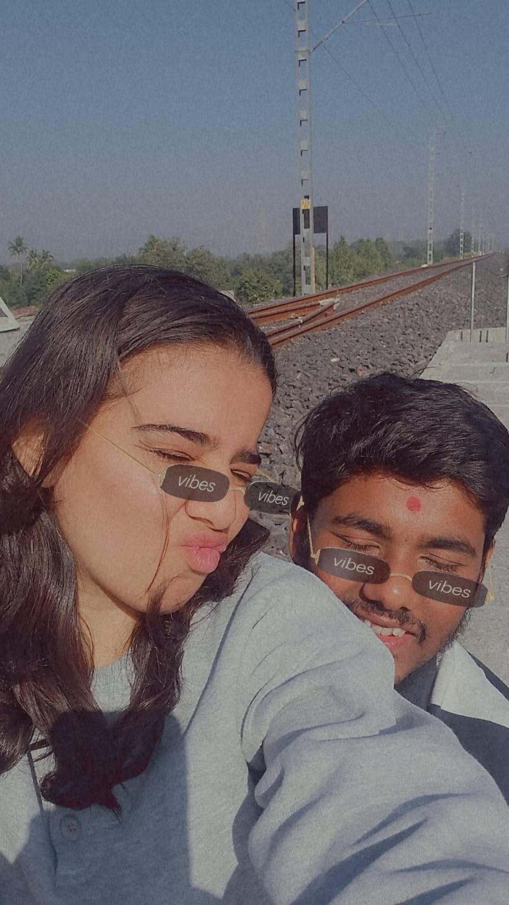

# Your photos go here

1. Copy your real photos into this folder (JPG, PNG or WebP).
2. Open `src/data/anniversaryContent.ts` and find `photos:`.
3. Add or edit one line per photo. The `file` must match the file name exactly.

The original files are never changed. The site only decides how to frame the
small thumbnail (`position`). When a photo is opened, the whole picture is shown,
uncropped.

Tip: resize very large phone photos to about 2000 px on the long side so the page
loads quickly on mobile data. Do this on your own computer, not with any
"enhance" or beauty tool.
